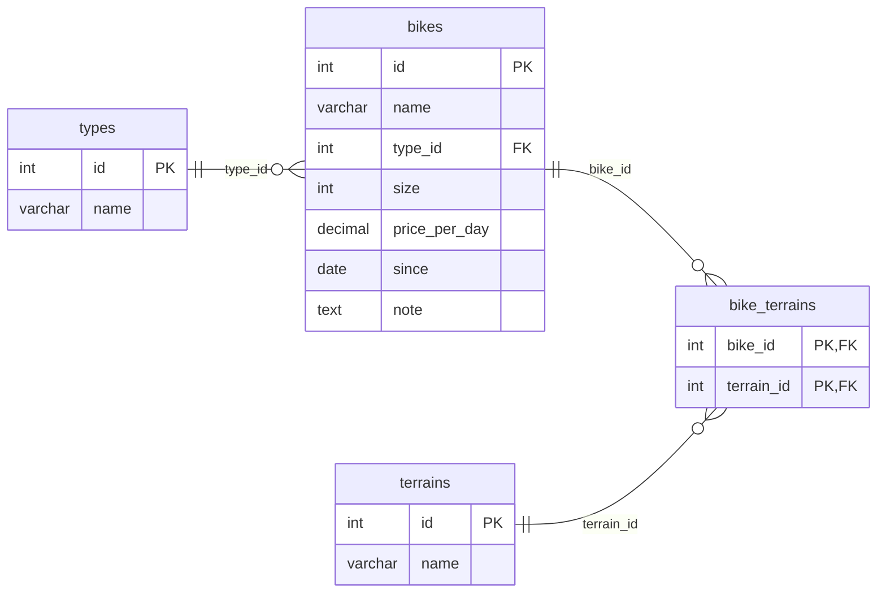
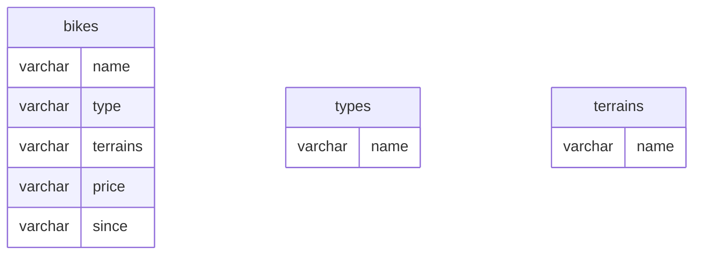

# cv06: Databáza a SQL

Stránka týždňa s teóriou a ukážkami: https://beata.stehlikova.website.tuke.sk/ti/07.html

## Odovzdávaš

V repository *cv06* na GitHub (na sigma sa z tohto repository nič nenahráva, všetko spúšťaš v Adminer vo svojej databáze):

- `models.md`: tvoj dátový model v tvare 1 + 2 + 1 ako text aj Mermaid (nadpis *Môj model*), vety k mazaniu (*Čo sa stalo pri mazaní*) a posúdenie modelov A a B (*Posúdenie*),
- `schema.sql`: `DROP TABLE IF EXISTS` a `CREATE TABLE` pre tvoje tables s primary keys, foreign keys a pravidlami `ON DELETE`,
- `seed.sql`: dáta na začiatok, štvrtý record main entity napísaný tebou,
- `queries.sql`: 16 query (15 podľa promptu + 1 vlastná) a úpravy z úlohy 7.6, každá s komentárom, koľko records vrátila.

Všetky štyri súbory sú v koreni repository (pri klonovaní prázdne, len s nadpismi a komentármi).

## Hodnotenie

1 bod. Súbory sú v repository, `schema.sql` a `seed.sql` bežia v Adminer od čistého stavu, `queries.sql` beží po jednej query, `models.md` má všetky tri časti. Commit a push najneskôr do nasledujúceho cvičenia. Po každom push sa spustia automatické testy; výsledok nájdeš podľa návodu [04 Odovzdávanie](https://beata.stehlikova.website.tuke.sk/navody/04-odovzdavanie.html), časť 6.

## Prompty pre AI

Na miestach `[DOPLŇ …]`, `[VLOŽ …]` a `-- DOPLŇ` dopĺňaš sám. Vzor lezeckej steny (Ukážky 1–4 na stránke) do svojej databázy nenahrávaj.

### Ukážka 5: prompt na dátový model

```text
Navrhujem databázu pre web na tému [DOPLŇ tému] (MariaDB). Potrebujem dátový model
v tomto tvare: jedna main entity, dva lookup tables a jedna pivot table (ďalšie lookup
tables len ak ich téma naozaj potrebuje). Prvý lookup table je k main entity pripojený
reláciou 1:N cez column [nazov]_id, druhý reláciou M:N cez pivot table.
Main entity má aspoň jeden column s data type DATE (napr. since alebo added).

Main entity je [DOPLŇ: čo eviduješ, napr. knihy]. Z môjho formulára mám tieto
zoznamy možností, z nich sprav lookup tables: [DOPLŇ: skopíruj array $grades a $styles
z content/register.php alebo opíš, čo je v select a radio]. Lookup table má len id a name,
prvý navyše číselný column value na priemery.

Výsledok napíš dvakrát:
1. ako text: pre každú table názov (anglicky, malé písmená, množné číslo), zoznam
   columns s data type (INT, DECIMAL, VARCHAR(n), TEXT, DATE), ktorý column je primary key,
   ktoré sú foreign keys a na čo odkazujú, a pri každom foreign key pravidlo ON DELETE
   (RESTRICT alebo CASCADE) s jednou vetou prečo;
2. ako Mermaid erDiagram s direction LR, v tables uveď columns s data type a PK/FK,
   čiary ||--o{ s názvom column.
Žiadne SQL, žiadna table používateľov, zatiaľ len model.
```

Prečo je prompt napísaný takto:

- **tvar 1 + 2 + 1 je pevný**: rovnaký ako vzor, takže každý ďalší týždeň prenesieš postup zo vzoru do svojho projektu,
- **lookup tables z tvojho form**: to, čo máš od cv05 v array pre select a radio (vo vzore `$grades` a `$styles`), sa stane tables a budúci týždeň ich form načíta z databázy,
- **ON DELETE s dôvodom**: pri obhajobe sa pýtame práve na to,
- **Mermaid**: text, z ktorého GitHub nakreslí obrázok priamo v `models.md`,
- **žiadne SQL**: najprv model, potom kód; SQL príde ďalším promptom, keď model schválíš.

### Ukážka 6: prompt na schema.sql a seed.sql

```text
Tu je môj dátový model (posielam). Vytvor pre MariaDB dva súbory.

schema.sql: na začiatku DROP TABLE IF EXISTS v opačnom poradí, potom CREATE TABLE
v poradí lookup tables, main entity, pivot table. Každá table CHARACTER SET utf8mb4,
id INT AUTO_INCREMENT PRIMARY KEY (pivot table má PRIMARY KEY z dvojice), NOT NULL
pri povinných columns, FOREIGN KEY s ON DELETE podľa modelu. Pri každom column
komentár -- čo obsahuje.

seed.sql: INSERT v rovnakom poradí ako CREATE TABLE, každá table jedným INSERT
s viacerými records oddelenými čiarkou: 3 records do každého lookup table, 4 records
do main entity (dva nech majú rovnakú hodnotu z prvého lookup table) a 3 records do
pivot table (jeden record main entity nech je v pivot table dvakrát, dva nech v nej
nie sú vôbec). Dáta na tému [DOPLŇ tému], slovensky s diakritikou. id sa v INSERT
nepíše. Do main entity napíš len tri records a INSERT ukonči bodkočiarkou; pod neho
daj komentár -- DOPLŇ: štvrtý record samostatným INSERT. Pivot table nech odkazuje
len na records 1 až 3.

[VLOŽ model]
```

Prečo takto: `DROP TABLE IF EXISTS` na začiatku znamená, že po každom pokazení spustíš súbor znova; rozloženie dát (dve rovnaké hodnoty, jeden record dvakrát v pivot table, dva vôbec) je také, aby `GROUP BY`, `JOIN` a `LEFT JOIN` ukázali rozdiel, inak všetky query vrátia to isté; jeden record dopíšeš sám, aby si vedel, ako `INSERT` vyzerá.

### Ukážka 7: prompt na queries.sql

```text
Tu je schema.sql a seed.sql mojej databázy (posielam). Napíš súbor queries.sql
s očíslovanými query pre MariaDB, pred každou komentár -- čo vypíše:
1. všetky columns main entity; 2. dva vybrané columns; 3. WHERE s podmienkou
na foreign key; 4. LIKE; 5. ORDER BY DESC; 6. DATEDIFF(CURDATE(), dátum z main entity)
AS days; 7. COUNT(*); 8. celý record s najnovším dátumom cez ORDER BY a LIMIT 1;
9. JOIN s prvým lookup table (columns z oboch tables s názvom table, AS pre rovnaké
názvy); 10. JOIN cez pivot table na druhý lookup table; 11. to isté s LEFT JOIN;
12. ROUND(AVG(value), 1) cez JOIN; 13. GROUP BY s COUNT podľa prvého lookup table;
14. GROUP BY s COUNT podľa druhého lookup table cez pivot table; 15. celý record
s najvyšším value cez ORDER BY a LIMIT 1. Query 16 nechaj prázdnu s komentárom
-- DOPLŇ: vlastná query z mojej témy.
Žiadne aliasy tables (žiadne r, g), píš celé názvy tables.
```

Prečo takto: pätnásť query zodpovedá Teórii v rovnakom poradí, pri každej vieš, čo má vyjsť; celé názvy tables, lebo `r.name` sa o týždeň nečíta; jednu query vymyslíš sám a tá sa pýta pri obhajobe.

## Úlohy

**Úloha 7.1: Adminer.** Podľa návodu [03 Sigma, časť 4](https://beata.stehlikova.website.tuke.sk/navody/03-sigma.html): stiahni Adminer for MySQL, premenuj na `adminer.php`, nahraj do webového priestoru a prihlás sa. Heslo k databáze dostaneš na cvičení. Po prihlásení klikni vľavo na názov svojej databázy a nájdi link **SQL command**.

**Úloha 7.2: Zadanie.** Prijmi zadanie *cv06* v Classroom 50 (link je na stránke týždňa) a repository naklonuj do `~/web/ti/cv06` podľa návodu [04 Odovzdávanie](https://beata.stehlikova.website.tuke.sk/navody/04-odovzdavanie.html), časti 2 a 3. Sú v ňom prázdne súbory `schema.sql`, `seed.sql`, `queries.sql` a `models.md` s tromi nadpismi.

**Úloha 7.3: Dátový model.** Prompt z Ukážky 5 so svojou témou a so zoznamami možností zo svojho `content/register.php` v cv05. Výsledok vlož do `models.md` pod nadpis *Môj model*: textový opis a pod ním blok Mermaid (medzi tri spätné apostrofy so slovom `mermaid`). Skontroluj tvar 1 + 2 + 1 a názvy (anglicky, malé písmená, `_id`). Po push otvor `models.md` na GitHub: obrázok modelu sa vykreslí sám.

**Úloha 7.4: schema.sql a seed.sql.** Prompt z Ukážky 6 so svojím modelom. Ulož ako `schema.sql` a `seed.sql`; namiesto komentára `-- DOPLŇ: štvrtý record` napíš vlastný štvrtý record ako samostatný `INSERT`. Potom vo svojej databáze spusti v SQL command najprv `schema.sql`, potom `seed.sql`. Preklikaj tables cez **Select data**; pri main entity si pozri foreign keys, ktoré Adminer ukazuje pod columns.

**Úloha 7.5: queries.sql.** Prompt z Ukážky 7. Ulož ako `queries.sql`, spusti každú query vo svojej databáze a nad ňu dopíš komentárom, koľko records vrátila (`-- 4 records`). Porovnaj s výsledkami v Teórii: tvoje dáta sú iné, ale tvar výsledku (počet columns, čo je `NULL`, jeden record pri `LIMIT 1`) má byť rovnaký. Query 16 napíš sám.

**Úloha 7.6: Úpravy výpisov rukou.** V `queries.sql` priamo uprav a spusti: v query 2 vymeň jeden column za iný; v query 5 zmeň smer zoradenia; v query 12 vymeň `AVG` za `MAX` a potom za `MIN`; do query 9 pridaj ďalší column z main entity (napríklad dátum); v query 13 zoraď namiesto podľa názvu lookup table podľa počtu zostupne (`ORDER BY` tvoj alias počtu `DESC`; ak query `ORDER BY` nemá, pridaj ho). Každú upravenú query nechaj v súbore pod pôvodnou s komentárom `-- upravené: čo`.

**Úloha 7.7: Mazanie a pravidlá.** Vyskúšaj na svojej databáze postup z Ukážky 4: `UPDATE` jednej hodnoty s `WHERE`; `DELETE` record main entity, ktorý je v pivot table, a pozri, čo sa stalo v pivot table; `DELETE` record lookup table, ktorý je v použití, a prečítaj chybu; `DROP TABLE` lookup table a prečítaj chybu; `DELETE` bez `WHERE` na pivot table a `COUNT(*)`; `DROP TABLE` pivot table a `SELECT` z nej. Do `models.md` pod nadpis *Čo sa stalo pri mazaní* napíš ku každému kroku jednu vetu. Nakoniec `schema.sql` + `seed.sql`.

**Úloha 7.8: Posúď dva modely.** Požičovňa bicyklov, dva návrhy; `types` sú typy bicyklov (horský, cestný), `terrains` terény, na ktoré sa bicykel hodí. Do `models.md` pod nadpis *Posúdenie* napíš, ktorý je nesprávny a aspoň tri konkrétne dôvody (ktorý column, ktorý record, čo sa stane pri sto bicykloch).

Model A:



`bikes.type_id` → `types.id` ON DELETE RESTRICT; `bike_terrains.bike_id` → `bikes.id` ON DELETE CASCADE; `bike_terrains.terrain_id` → `terrains.id` ON DELETE RESTRICT.

Model B:



Dáta v `bikes` napríklad: `('Trek 500', 'horský', 'les, cesta', '12 €', 'jar 2025')`, `('Kona Dew', 'Horsky', 'cesta', '10', '2024-03-01')`.

**Úloha 7.9: Commit a push.** Podľa návodu 04, časť 5; commit po každej hotovej úlohe. Výsledok testov podľa časti 6. Na sigma sa dnes nič nenahráva.

**Hodnotenie:** 1 bod. V repository *cv06* na GitHub je `models.md` s modelom v tvare 1 + 2 + 1 (text aj Mermaid), vetami k mazaniu (úloha 7.7) a posúdením modelov A a B (úloha 7.8), `schema.sql` s aspoň štyrmi tables, kľúčmi a pravidlami `ON DELETE`, `seed.sql` s dátami a `queries.sql` so šestnástimi query a úpravami z úlohy 7.6, ktoré v Adminer bežia. Commit a push najneskôr do nasledujúceho cvičenia.

---

# cv06: Database and SQL

The week page with theory and examples: https://beata.stehlikova.website.tuke.sk/ti/07.html

## What you submit

In the repository *cv06* on GitHub (nothing from this repository is uploaded to sigma, you run everything in Adminer in your own database):

- `models.md`: your data model in the shape 1 + 2 + 1 as text and Mermaid (heading *Môj model*), the sentences about deleting (*Čo sa stalo pri mazaní*) and the judgement of models A and B (*Posúdenie*),
- `schema.sql`: `DROP TABLE IF EXISTS` and `CREATE TABLE` for your tables with primary keys, foreign keys and `ON DELETE` rules,
- `seed.sql`: the data to start with, the fourth record of the main entity written by you,
- `queries.sql`: 16 queries (15 from the prompt + 1 of your own) and the edits from task 7.6, each with a comment saying how many records it returned.

All four files are in the root of the repository (empty when cloned, only with headings and comments).

## Grading

1 point. The files are in the repository, `schema.sql` and `seed.sql` run in Adminer from a clean state, `queries.sql` runs one query at a time, `models.md` has all three parts. Commit and push by the next lab at the latest. After every push the automatic tests run; you find the result following guide [04 Submitting](https://beata.stehlikova.website.tuke.sk/navody/04-odovzdavanie.html), part 6.

## AI prompts

You fill in `[FILL IN …]`, `[PASTE …]` and `-- DOPLŇ` yourself. Do not load the climbing-wall sample (Examples 1–4 on the page) into your own database.

### Example 5: a prompt for the data model

```text
I am designing a database for a website about [FILL IN the topic] (MariaDB). I need a data
model in this shape: one main entity, two lookup tables and one pivot table (further
lookup tables only if the topic really needs them). The first lookup table is joined to
the main entity by a relation 1:N through the column [name]_id, the second by a relation
M:N through the pivot table. The main entity has at least one column with the data type
DATE (e.g. since or added).

The main entity is [FILL IN: what you keep records of, e.g. books]. From my form I have
these lists of options, make them the lookup tables: [FILL IN: copy the arrays $grades and
$styles from content/register.php or describe what is in the select and radio]. A lookup
table has only id and name, the first one also a numeric column value for averages.

Write the result twice:
1. as text: for each table its name (English, lowercase, plural), the list of columns with
   their data type (INT, DECIMAL, VARCHAR(n), TEXT, DATE), which column is the primary key,
   which are foreign keys and what they refer to, and for each foreign key the ON DELETE
   rule (RESTRICT or CASCADE) with one sentence why;
2. as a Mermaid erDiagram with direction LR; in the tables give the columns with data type
   and PK/FK, lines ||--o{ with the column name.
No SQL, no users table, just the model for now.
```

Why the prompt is written like this:

- **the shape 1 + 2 + 1 is fixed**: the same as the sample, so every following week you transfer the procedure from the sample to your project,
- **lookup tables from your form**: what you have had since cv05 in your select/radio arrays (in the sample `$grades` and `$styles`) becomes tables, and next week your form loads them from the database,
- **ON DELETE with a reason**: that is exactly what we ask about at the defence,
- **Mermaid**: text from which GitHub draws the picture directly in `models.md`,
- **no SQL**: the model first, the code after; the SQL comes with the next prompt once you approve the model.

### Example 6: a prompt for schema.sql and seed.sql

```text
Here is my data model (attached). Create two files for MariaDB.

schema.sql: at the start DROP TABLE IF EXISTS in the opposite order, then CREATE TABLE in
the order lookup tables, main entity, pivot table. Every table CHARACTER SET utf8mb4,
id INT AUTO_INCREMENT PRIMARY KEY (the pivot table has a PRIMARY KEY of the pair), NOT NULL
for required columns, FOREIGN KEY with ON DELETE according to the model. At each column
a comment -- what it contains.

seed.sql: INSERT in the same order as CREATE TABLE, each table with one INSERT with several
records separated by commas: 3 records into each lookup table, 4 records into the main
entity (two of them with the same value from the first lookup table) and 3 records into
the pivot table (one record of the main entity twice in the pivot table, two not in it at
all). Data about [FILL IN the topic], in Slovak or English (with accents where needed). id is not written in INSERT.
Write only three records into the main entity and end the INSERT with a semicolon; under
it put the comment -- DOPLŇ: štvrtý record samostatným INSERT. The pivot table refers
only to records 1 to 3.

[PASTE the model]
```

Why like this: `DROP TABLE IF EXISTS` at the start means you can run the file again after every mishap; the layout of the data (two equal values, one record twice in the pivot table, two not at all) is such that `GROUP BY`, `JOIN` and `LEFT JOIN` show a difference, otherwise all queries return the same thing; you write one record yourself so that you know what an `INSERT` looks like.

### Example 7: a prompt for queries.sql

```text
Here are schema.sql and seed.sql of my database (attached). Write the file queries.sql with
numbered queries for MariaDB, before each a comment -- what it lists:
1. all columns of the main entity; 2. two chosen columns; 3. WHERE with a condition on
a foreign key; 4. LIKE; 5. ORDER BY DESC; 6. DATEDIFF(CURDATE(), a date from the main
entity) AS days; 7. COUNT(*); 8. the whole record with the newest date through ORDER BY
and LIMIT 1; 9. JOIN with the first lookup table (columns from both tables with the table
name, AS for equal names); 10. JOIN through the pivot table to the second lookup table;
11. the same with LEFT JOIN; 12. ROUND(AVG(value), 1) through JOIN; 13. GROUP BY with
COUNT by the first lookup table; 14. GROUP BY with COUNT by the second lookup table
through the pivot table; 15. the whole record with the highest value through ORDER BY
and LIMIT 1. Leave query 16 empty with the comment -- DOPLŇ: vlastná query z mojej témy.
No table aliases (no r, g), write the full table names.
```

Why like this: the fifteen queries correspond to the Theory in the same order, for each you know what should come out; full table names, because `r.name` is unreadable a week later; you make up one query yourself and that one is asked at the defence.

## Tasks

**Task 7.1: Adminer.** Following guide [03 Sigma, part 4](https://beata.stehlikova.website.tuke.sk/navody/03-sigma.html): download Adminer for MySQL, rename it to `adminer.php`, upload it to your web space and log in. You get the database password in the lab. After logging in, click the name of your database on the left and find the link **SQL command**.

**Task 7.2: The assignment.** Accept the assignment *cv06* in Classroom 50 (the link is on the week page) and clone the repository into `~/web/ti/cv06` following guide [04 Submitting](https://beata.stehlikova.website.tuke.sk/navody/04-odovzdavanie.html), parts 2 and 3. It contains the empty files `schema.sql`, `seed.sql`, `queries.sql` and `models.md` with three headings.

**Task 7.3: The data model.** The prompt from Example 5 with your topic and the lists of options from your `content/register.php` in cv05. Put the result into `models.md` under the heading *Môj model* (the headings in the template are Slovak): the text description and under it the Mermaid block (between three backticks with the word `mermaid`). Check the shape 1 + 2 + 1 and the names (English, lowercase, `_id`). After the push open `models.md` on GitHub: the picture of the model is drawn by itself.

**Task 7.4: schema.sql and seed.sql.** The prompt from Example 6 with your model. Save as `schema.sql` and `seed.sql`; instead of the comment `-- DOPLŇ: štvrtý record` write your own fourth record as a separate `INSERT`. Then in your own database run `schema.sql` first in SQL command, then `seed.sql`. Click through the tables with **Select data**; at the main entity look at the foreign keys Adminer shows under the columns.

**Task 7.5: queries.sql.** The prompt from Example 7. Save as `queries.sql`, run each query in your own database and write above it in a comment how many records it returned (`-- 4 records`). Compare with the results in the Theory: your data is different, but the shape of the result (the number of columns, what is `NULL`, one record with `LIMIT 1`) should be the same. Write query 16 yourself.

**Task 7.6: Changing the listings by hand.** Edit and run directly in `queries.sql`: in query 2 swap one column for another; in query 5 change the sort direction; in query 12 swap `AVG` for `MAX` and then for `MIN`; add another column from the main entity (for example the date) to query 9; in query 13 sort by the count descending instead of by the lookup-table name (`ORDER BY` your count alias `DESC`; add `ORDER BY` if the query has none). Leave each edited query in the file under the original with the comment `-- upravené: ` and what you changed.

**Task 7.7: Deleting and the rules.** Try the procedure from Example 4 on your database: `UPDATE` of one value with `WHERE`; `DELETE` of a record of the main entity that is in the pivot table, and see what happened in the pivot table; `DELETE` of a lookup-table record in use, and read the error; `DROP TABLE` of a lookup table, and read the error; `DELETE` without `WHERE` on the pivot table and `COUNT(*)`; `DROP TABLE` of the pivot table and a `SELECT` from it. In `models.md` under the heading *Čo sa stalo pri mazaní* write one sentence for each step. Finally `schema.sql` + `seed.sql`.

**Task 7.8: Judge two models.** A bike rental, two designs; `types` are bike types (mountain, road), `terrains` the terrains a bike is suited for. In `models.md` under the heading *Posúdenie* write which one is wrong and at least three concrete reasons (which column, which record, what happens with a hundred bikes).

Model A:


`bikes.type_id` → `types.id` ON DELETE RESTRICT; `bike_terrains.bike_id` → `bikes.id` ON DELETE CASCADE; `bike_terrains.terrain_id` → `terrains.id` ON DELETE RESTRICT.

Model B:


Data in `bikes` for example: `('Trek 500', 'horský', 'les, cesta', '12 €', 'jar 2025')`, `('Kona Dew', 'Horsky', 'cesta', '10', '2024-03-01')`.

**Task 7.9: Commit and push.** Following guide 04, part 5; commit after every finished task. The test results following part 6. Nothing is uploaded to sigma today.

**Grading:** 1 point. In the repository *cv06* on GitHub there is `models.md` with a model in the shape 1 + 2 + 1 (text and Mermaid), the sentences about deleting (task 7.7) and the judgement of models A and B (task 7.8), `schema.sql` with at least four tables, keys and `ON DELETE` rules, `seed.sql` with data and `queries.sql` with sixteen queries and the edits from task 7.6, all running in Adminer. Commit and push by the next lab at the latest.
